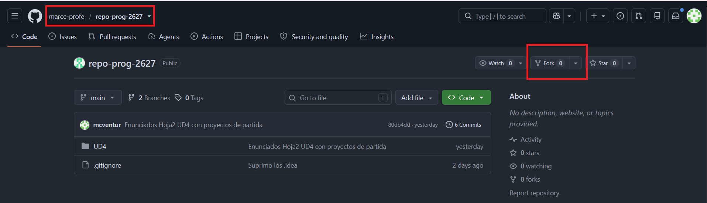
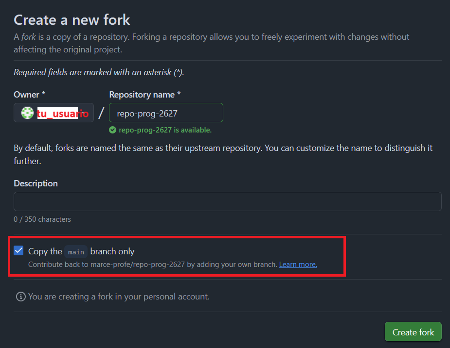

# Programación (1º DAM) — Repositorio de la asignatura

Aquí encontrarás los **enunciados** y los **proyectos de partida** de los ejercicios. Iré publicando material nuevo a lo largo del curso.

Este documento explica cómo trabajar con el repositorio **desde el primer día**. Léelo entero una vez y vuelve a él cuando tengas dudas.

---

## 0. Idea general

No trabajas directamente sobre mi repositorio. Cada alumno/a tiene **su propia copia en GitHub** (un *fork*) y trabaja sobre ella.

```
 REPO DEL PROFE (upstream)        TU FORK (origin)              TU ORDENADOR
 marce-profe/repo-prog-2627  ──▶  <tu-usuario>/repo-prog-2627  ◀──▶  carpeta local
        (solo lo modifica el profe)    (tu copia en GitHub)         (donde programas)
```

- **`origin`** = tu fork. Aquí **subes** (`push`) tu trabajo.
- **`upstream`** = el repo del profe. De aquí **traes** (`fetch` + `merge`) el material nuevo.
- **Nunca** se sube nada al repo del profe.

---

## 1. Preparación (se hace UNA sola vez)

### 1.1 Crear el fork

1. Entra en <https://github.com/marce-profe/repo-prog-2627> con tu cuenta de GitHub.
2. Pulsa el botón **Fork** (arriba a la derecha).



3. Deja **marcada** la casilla **"Copy the main branch only"**.


4. Pulsa **Create fork**.

Ahora tienes `https://github.com/<tu-usuario>/repo-prog-2627`.

<!-- CAPTURA 1: botón Fork y pantalla de creación con la casilla "Copy the main branch only" marcada -->

### 1.2 Clonar TU fork

Abre una terminal (Git Bash, o la terminal de IntelliJ) en la carpeta donde quieras guardar la asignatura:

```bash
git clone https://github.com/<tu-usuario>/repo-prog-2627.git
cd repo-prog-2627
```

- `git clone` descarga tu fork al ordenador.
- Git crea automáticamente un remoto llamado **`origin`** que apunta a tu fork.

> ⚠️ Clona **tu** fork (con tu usuario), **no** el repo del profe.

### 1.3 Añadir el repo del profe como `upstream`

```bash
git remote add upstream https://github.com/marce-profe/repo-prog-2627.git
```

Un *remoto* es un nombre corto (alias) para la dirección de otro repositorio. Este comando **no descarga nada**: solo registra que `upstream` es el repo del profe.

### 1.4 Comprobar que está bien

```bash
git remote -v
```

Debe salir algo así (con tu usuario en `origin`):

```
origin    https://github.com/<tu-usuario>/repo-prog-2627.git (fetch)
origin    https://github.com/<tu-usuario>/repo-prog-2627.git (push)
upstream  https://github.com/marce-profe/repo-prog-2627.git (fetch)
upstream  https://github.com/marce-profe/repo-prog-2627.git (push)
```

<!-- CAPTURA 2: salida de git remote -v -->

Si falta `upstream` o `origin` apunta al repo del profe, **avísame antes de seguir**.

---

## 2. ⚠️ Precauciones (léelas, de verdad)

1. **Comprueba SIEMPRE en qué rama estás antes de empezar a trabajar.**
   ```bash
   git branch        # la rama activa lleva un asterisco *
   ```
   En IntelliJ aparece arriba, junto al nombre del proyecto. Para trabajar, debes estar en **`main`**.

   <!-- CAPTURA 3: indicador de rama en IntelliJ -->

2. **Antes de traer material nuevo, haz commit de lo tuyo.** `git status` debe decir *"nothing to commit, working tree clean"*.
3. **No edites ficheros desde la web de GitHub** en tu fork. Si lo haces, tu fork y tu ordenador quedan distintos y aparecen líos al sincronizar.
4. **No hagas `merge` ni `pull` de la rama de soluciones del profe.** Las soluciones modifican los mismos ficheros que tú editas: pisarían o mezclarían tu código. Las soluciones **solo se consultan** (ver apartado 5).
5. **No uses `git push --force`** ni comandos que no entiendas. Si algo sale raro, **para y pregunta**.
6. **No borres la carpeta del proyecto** para "empezar de cero" sin haber hecho `push` antes: perderías lo que no esté subido.
7. **Haz `push` con frecuencia.** Lo que solo está en tu ordenador no tiene copia de seguridad.

---

## 3. Flujo de trabajo diario

Cada vez que te sientas a trabajar:

```bash
git status          # 1. ¿Estoy en main y sin cambios pendientes?
git branch          #    (confirma que el * está en main)
```

Programas (IntelliJ / BlueJ) y, al terminar un ejercicio o una sesión:

```bash
git status                                   # 2. Qué ha cambiado
git add .                                    # 3. Preparar los cambios
git commit -m "Ejercicio 1 hoja 2 UD4"       # 4. Guardar una "foto" con un mensaje claro
git push                                     # 5. Subir a tu fork (origin)
```

- Mensajes de commit **claros**: qué ejercicio has hecho (`"UD4 Hoja 2 - Ejercicio 3"`), no `"cambios"` ni `"asdf"`.
- Tras el `push`, entra en `github.com/<tu-usuario>/repo-prog-2627` y comprueba que tus cambios aparecen.

---

## 4. Traer material nuevo del profe

Cuando yo publique enunciados o proyectos nuevos (te lo diré en clase), tu fork **no se actualiza solo**. Debes traerlos tú:

```bash
# 0. Antes de nada: ¿estás en main y con todo commiteado?
git status
git branch

# 1. Descargar lo nuevo del profe (no toca tus ficheros todavía)
git fetch upstream

# 2. Incorporarlo a tu rama main
git merge upstream/main --no-edit

# 3. Subir el resultado a tu fork
git push
```

Aparecerán carpetas o ficheros nuevos (por ejemplo, la hoja siguiente). Tu trabajo anterior sigue intacto.

> 💡 Alternativa desde la web: en tu fork, botón **Sync fork → Update branch**. Después, en tu ordenador, ejecuta `git pull`. (Sigue valiendo la regla: antes de hacer `git pull` en local, tus cambios deben estar commiteados.)

<!-- CAPTURA 4: botón "Sync fork" en GitHub -->

### ¿Y si sale un conflicto?

Si Git dice `CONFLICT` o `Automatic merge failed`, **no entres en pánico ni borres nada**. Cancela la operación con:

```bash
git merge --abort
```

Tu proyecto vuelve a como estaba antes. Después, **avísame** y lo resolvemos juntos. Los conflictos solo ocurren si yo corrijo un fichero que tú ya habías modificado.

### Si Git se niega a hacer el merge

Si te dice que tienes cambios sin commitear que se sobrescribirían, haz primero `git add .` y `git commit` (apartado 3) y repite el proceso. Es una protección, no un error.

---

## 5. Consultar las soluciones

Las soluciones las publicaré en otra rama de **mi** repositorio (`soluciones-profe`), a medida que se corrija cada hoja. **No están en tu fork.**

Para verlas:

1. Entra en <https://github.com/marce-profe/repo-prog-2627>.
2. Pulsa el selector de ramas (donde pone `main`) y elige **`soluciones-profe`**.
3. Navega por las carpetas y lee el código en la web.

<!-- CAPTURA 5: selector de ramas en el repo del profe con soluciones-profe -->

Si quieres compararlas con tu código, **copia y pega** lo que te interese a mano, o pregúntame cómo abrirlas en una segunda ventana de IntelliJ.

> ⛔ Recuerda: **solo consultar**. No hagas `merge` de esa rama en tu trabajo.

---

## 6. Resumen rápido (chuleta)

| Quiero… | Comando |
|---|---|
| Ver en qué rama estoy | `git branch` |
| Ver qué ha cambiado | `git status` |
| Guardar mi trabajo | `git add .` → `git commit -m "mensaje"` |
| Subirlo a mi fork | `git push` |
| Traer novedades del profe | `git fetch upstream` → `git merge upstream/main --no-edit` → `git push` |
| Ver mis remotos | `git remote -v` |
| Cancelar un merge con conflictos | `git merge --abort` |

**Reglas de oro:** trabaja en `main` · verifica la rama antes de empezar · commit antes de traer novedades · nunca hagas merge de las soluciones · ante la duda, pregunta antes de ejecutar.
