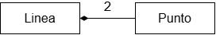
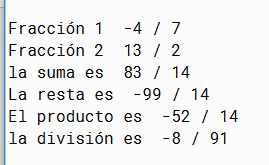
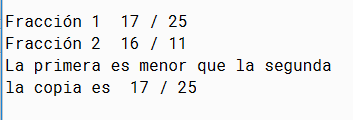
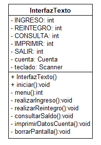

# Ejercicios adicionales UT4 (II) – Interacción de objetos

## Ejercicio 5

Crea en `C:\Programacion\UT4` un nuevo proyecto `AD03_4_CirculoPunto`. El proyecto consta de dos clases,
`Linea` y `Punto`. La clase `Punto` del ejercicio anterior nos puede servir: cópiala al proyecto
nuevo desde el proyecto `AD03_04 Circulo y Punto`.  

El diagrama de clases muestra una
composición: *una línea consta de dos puntos*.



- Añade a la clase `Punto` un método `public void desplaza(int distanciaX, int distanciaY)` que
  permite desplazar el punto en el plano la distancia indicada por los parámetros.
- Crea ahora la clase `Linea` que incluye dos atributos, *punto1* y *punto2*, de la clase `Punto`.
- Incorpora dos constructores: el primero sin parámetros (el constructor predeterminado) crea los
  dos puntos que forman la línea con valores iniciales (0,0) ambos. El segundo constructor recibe
  como parámetros dos objetos de la clase `Punto` que son utilizados para inicializar los
  atributos.
- Añade a la clase los métodos:

  ```java
  public void moverDerecha(int distancia)
  public void moverIzquierda(int distancia)
  public void moverArriba(int distancia)
  public void moverAbajo(int distancia)
  ```

  que desplazan la línea a la derecha, izquierda, arriba y abajo, respectivamente, la distancia que
  se indica como parámetro.
- Añade accesores y mutadores para los dos puntos que forman la línea.
- Incluye un método `printLinea()` que muestre en pantalla la información de la línea:

  ```
  Punto 1 -  Valor de x = 3
             Valor de y = 2
  Punto 2 -  Valor de x = 12
             Valor de y = 10
  ```

- Prueba las clases `Punto` (método `desplaza()`) y `Linea` creando una clase `Test` con su método
  `main`.

## Ejercicio 6

Descarga el proyecto `AD06_Fraccion` del aula Moodle y complétalo. La clase representa fracciones
y tiene dos atributos enteros, *numerador* y *denominador*, y los siguientes constructores y
métodos:

- constructor sin parámetros que inicializa los atributos a 0
- constructor con dos parámetros, *numerador* y *denominador*
- accesores y mutadores para los dos atributos
- `public Fraccion sumar(Fraccion otra)` – suma la fracción actual con la recibida como parámetro
- `public Fraccion restar(Fraccion otra)` – ídem calculando la resta
- `public Fraccion multiplicar(Fraccion otra)` – multiplica dos fracciones
- `public Fraccion dividir(Fraccion otra)` – divide dos fracciones
- `public boolean igualQue(Fraccion otra)` – devuelve `true` si las fracciones son iguales,
  `false` en otro caso
- `public boolean menorQue(Fraccion otra)` – devuelve `true` si la fracción actual es menor que la
  recibida como parámetro
- `public Fraccion clonar()` – devuelve una nueva fracción idéntica a la actual
- `public String toString()` – devuelve una representación de la fracción de la forma `"xx / yy"`

Añade al proyecto una clase `DemoFraccion` que incluye:

- dos atributos *fraccion1* y *fraccion2* de tipo `Fraccion`
- un constructor sin parámetros que crea *fraccion1* a –4 / 7 y *fraccion2* a 13 / 2
- un método público `demo1()`. Este método no tiene parámetros ni devuelve nada. Dentro del
  método:
  - calcula la suma, resta, producto y división de las dos fracciones
  - escribe el resultado. Para ello se hará uso del método privado
    `private void escribirFraccion(String mensaje, Fraccion fraccion)` que muestra una sola
    fracción en la pantalla precedida de un mensaje aclaratorio, por ejemplo, "Fracción 1" o
    "La suma es", …

  Salida esperada:

  

- un método público `demo2()` en el que:
  - se modifica *fraccion1* para que ahora sea la fracción 17 / 25 y *fraccion2* para que sea
    16 / 11 (no hay que llamar a ningún constructor)
  - se compara *fraccion1* en relación a *fraccion2* escribiendo en pantalla si es menor o si son
    iguales
  - se realiza una copia de *fraccion1* visualizando en pantalla el valor de la copia. Utiliza en
    este último caso el método privado anterior `escribirFraccion()`

  Salida esperada:

  

- un método `main` que crea un objeto de la clase `DemoFraccion` y llama primero a `demo1()` y
  luego a `demo2()`.

## Ejercicio 7

Abre el proyecto `AD07 CuentaBancaria`. El proyecto contiene una clase `Cuenta` que representa una
cuenta corriente. De una cuenta se conoce el nº de cuenta, el saldo y el nombre de su único
titular. Sobre una cuenta se puede realizar el ingreso y el reintegro de una determinada cantidad.
Además es posible consultar el saldo y obtener una representación textual del estado de la cuenta.
Las cuentas se crean con un nº de cuenta y un titular determinado pero con saldo inicial 0.
Asegúrate de que entiendes bien el código de esta clase. No hay que modificarla.

Añade al proyecto una nueva clase `InterfazTexto`. Un objeto de esta clase va a permitir al
usuario interactuar con una cuenta corriente de manera que pueda seleccionar la operación a
realizar sobre la cuenta.



- La clase define cinco constantes con valores de 1 a 5 que representan las diferentes opciones
  que el usuario puede elegir para trabajar con la cuenta.
- Los atributos de esta clase son la cuenta sobre la que trabajaremos y el teclado que nos
  permitirá aceptar datos desde la consola.
- El constructor crea el teclado.
- El método público `iniciar()` es el método principal que controla la lógica de funcionamiento de
  un objeto de esta clase. Primero solicita el nº de cuenta y el nombre del titular y con estos
  datos se crea la cuenta con la que se va a trabajar.
- A continuación presenta al usuario un menú en la pantalla del estilo:

  ```
  1.- Ingreso
  2.- Reintegro
  3.- Consulta
  4.- Imprimir datos cuenta
  5.- Salir
  Elija opcion:
  ```

- El método `menu()` presenta el menú anterior en pantalla e indica al usuario que elija una
  opción; la opción se lee desde teclado y se devuelve.
- Dependiendo de la opción elegida por el usuario se ejecuta el método adecuado:
  `realizarIngreso()`, `realizarReintegro()`, … Cuando se realiza un reintegro o ingreso, dentro
  del método encargado de esta acción se solicita al usuario la cantidad a ingresar o sacar.
- El método `borrarPantalla()` borra la pantalla.

Añade al proyecto la clase `AplicacionCuentaBancaria`. Esta clase va a ser la clase que contenga
el método `main()` y por tanto la clase necesaria para ejecutar de forma autónoma la aplicación.
Esta clase solo contiene a este método y lo único que hace es:

- crear un objeto `InterfazTexto`
- llamar al método `iniciar()`

Recuerda que no es necesario que exista ningún objeto de la clase `AplicacionCuentaBancaria` para
ejecutar el método `main()`: es un método de clase y no necesita instancias para su ejecución.
